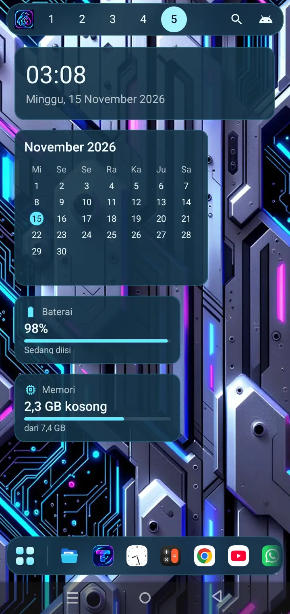
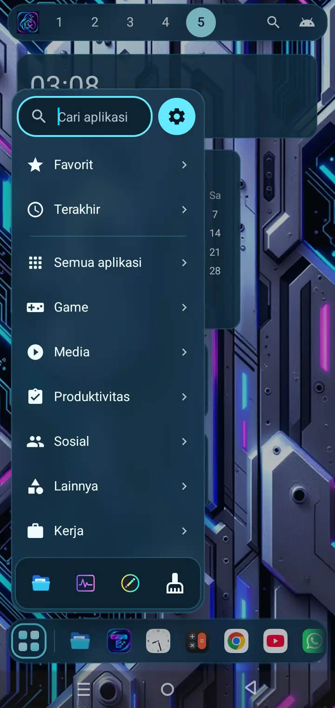
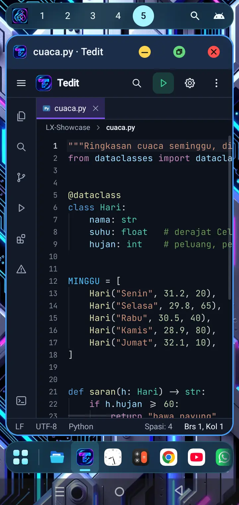
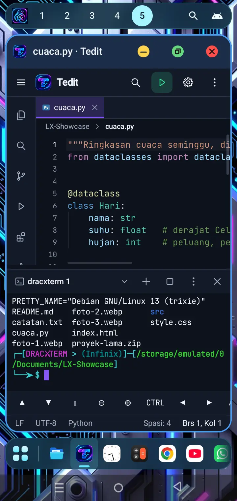
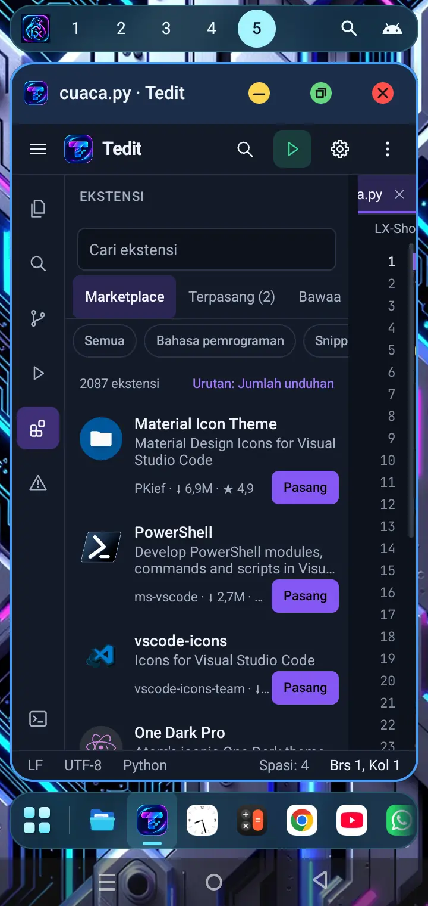
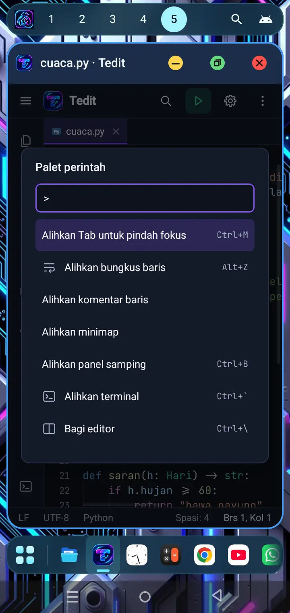
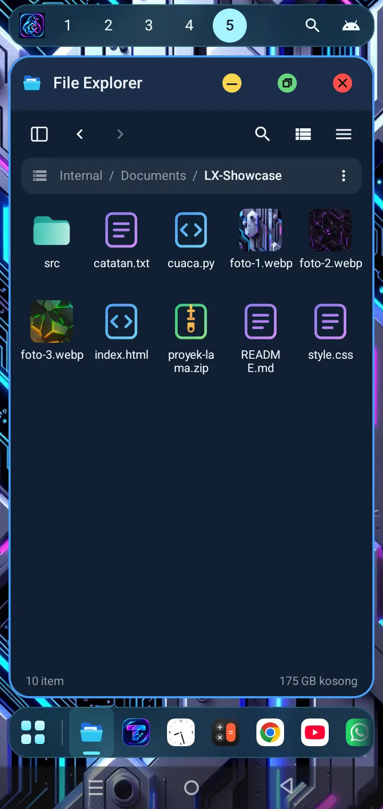
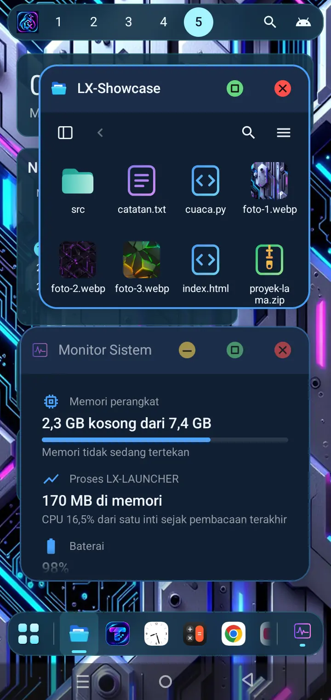
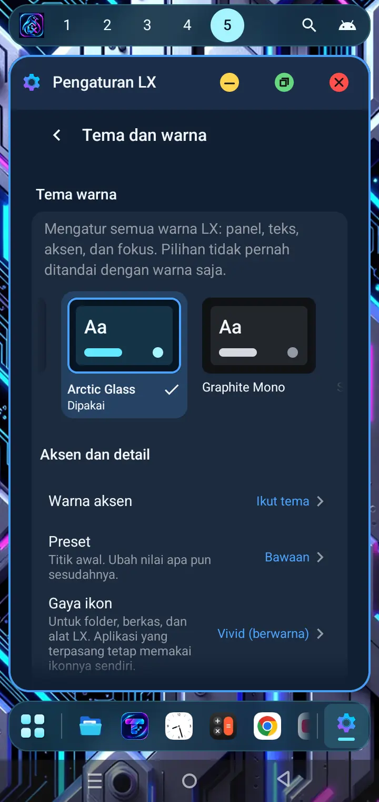
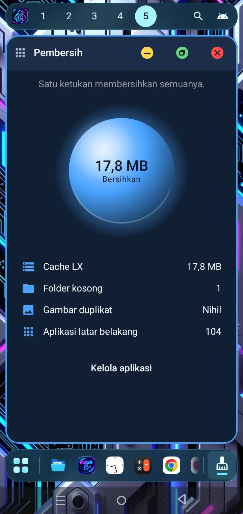

# LX-LAUNCHER

Layar Home Android yang terasa seperti desktop Linux 🐧 Ada panel atas, dock, nomor workspace, widget yang bisa dipindah, dan jendela yang bisa digeser, diperbesar, atau ditempel ke sisi layar. Di dalamnya ada Tedit, editor kode bergaya VS Code yang bisa memasang Debian 13 dari dalam APK. Jadi kode yang Anda tulis di ponsel bisa langsung dijalankan di ponsel itu juga, tanpa root.

Versi **1.0.0**, 15 November 2026. Diuji di Infinix HOT 60 5G dengan Android 15. Versi sebelumnya juga diuji di Waydroid (Android 13).

[Unduh APK](https://sourceforge.net/projects/lx-launcher/files/latest/download) · [Halaman SourceForge](https://sourceforge.net/projects/lx-launcher/)

## Lihat dulu 👀

<table>
  <tr>
    <td align="center" valign="top" width="50%">
      <br>
      Desktop dengan widget jam, kalender, baterai, dan memori. Angka di panel atas adalah workspace, ketuk untuk pindah.
    </td>
    <td align="center" valign="top" width="50%">
      <br>
      Menu Aplikasi: Favorit, Terakhir, lalu kategori. Di baris bawahnya ada File Explorer, Monitor Sistem, Catatan, dan Pembersih.
    </td>
  </tr>
  <tr>
    <td align="center" valign="top">
      <br>
      Tedit membuka berkas Python lengkap dengan warna sintaks, nomor baris, dan tab, mirip VS Code.
    </td>
    <td align="center" valign="top">
      <br>
      Terminal di bawah editor menjalankan bash di Debian 13. Perintah diketik di ponsel, hasilnya berwarna.
    </td>
  </tr>
  <tr>
    <td align="center" valign="top">
      <br>
      Panel Ekstensi mencari ke Open VSX. Di sini kategori Tema: ketuk Pasang, lalu pilih temanya.
    </td>
    <td align="center" valign="top">
      <br>
      Palet perintah (Ctrl Shift P) memuat semua perintah Tedit beserta pintasan keyboardnya.
    </td>
  </tr>
  <tr>
    <td align="center" valign="top">
      <br>
      File Explorer menampilkan isi folder, dengan pratinjau gambar dan ikon untuk kode, teks, dan arsip.
    </td>
    <td align="center" valign="top">
      <br>
      Dua jendela di atas desktop sekaligus. Geser dari bilah judul, ubah ukurannya dari tepi.
    </td>
  </tr>
  <tr>
    <td align="center" valign="top">
      <br>
      Pengaturan LX &gt; Tema dan warna. Setiap tema punya pratinjau, dan pilihannya langsung terlihat di seluruh LX.
    </td>
    <td align="center" valign="top">
      <br>
      Pembersih menghitung cache, folder kosong, gambar ganda, dan aplikasi yang jalan di latar. Satu ketukan pada bolanya untuk membersihkan.
    </td>
  </tr>
</table>

Semua gambar diambil di ponsel uji dengan folder dan workspace contoh, tanpa data pribadi.

## Isinya apa saja

### 🖥️ Desktop yang terasa seperti Linux

Tombol di ujung kiri bilah bawah membuka menu Aplikasi. Kategorinya tersusun di satu kolom, dan aplikasi dalam kategori yang Anda ketuk muncul sebagai submenu di sebelahnya, seperti menu desktop. Ketik untuk mencari, atau buka Favorit dan Terakhir.

Aplikasi bisa ditaruh di desktop, di dock, atau di taskbar. Tekan lama area kosong desktop, pilih Tambah aplikasi, lalu ketuk aplikasinya. Seret satu ikon ke ikon lain untuk membuat folder.

Ada empat workspace, masing-masing dengan widget dan jendelanya sendiri, dan bisa ditambah sampai dua belas. Widgetnya ada jam, kalender, baterai, memori, penyimpanan, jaringan, kontrol media, catatan cepat, dan aplikasi favorit, ditambah widget dari aplikasi lain yang terpasang. Wallpaper bisa memakai foto sendiri. LX menyimpan salinannya, jadi wallpaper tetap ada walau foto aslinya dihapus.

Di ponsel yang dipegang tegak, dock dan taskbar menyatu di bawah supaya terjangkau ibu jari. Di tablet, dock berdiri di sisi kiri. Dengan keyboard: Ctrl K untuk mencari, Ctrl Shift A untuk menu Aplikasi, Ctrl 1 sampai 9 untuk pindah workspace, dan Alt F4 untuk menutup jendela.

### 🪟 Jendela

Pengaturan LX, File Explorer, Tedit, Monitor Sistem, Catatan, dan Pembersih terbuka sebagai jendela. Jendela bisa digeser, diubah ukurannya dari tepi, diperkecil ke taskbar, dan saat dibuka lagi kembali ke posisi terakhirnya. Sampai ukuran terkecilnya pun isinya tetap rapi.

Gaya bawaannya LX Modern Gelap. Ada sepuluh gaya lain, dari Minimalis Gelap dan Glassmorphism sampai Retro dan Hybrid Desktop Linux, juga Ikut tema LX. Pilih di Pengaturan LX &gt; Jendela dan panel, atau tekan lama bilah judul. Gaya Kustom mengatur sendiri sudut, tepi, tinggi bilah judul, tombol, bayangan, dan aksennya.

Aplikasi Android juga bisa dibuka dalam jendela LX, lengkap dengan bilah judul sesuai gaya Anda. Di Android 14 ke atas, ketuk Sambungkan otomatis dan nyalakan satu izin, lalu LX memasang LX Bridge sendiri. Pilih Layar penuh di menu jendela kalau ingin aplikasi memakai seluruh layar, dan tekan Kembali untuk mengembalikan ukurannya.

### ✍️ Tedit, editor kode di dalam LX

Tampilannya mengikuti VS Code: rail untuk Berkas, Cari, Kontrol Sumber, Jalankan dan Debug, Ekstensi, dan Masalah, lalu tab, split editor, palet perintah, dan warna sintaks untuk sekitar 30 bahasa. Buka dari tombolnya di bilah bawah, dari pencarian LX dengan mengetik Tedit, atau dengan mengetuk berkas di File Explorer.

Tedit membaca repositori git di folder yang dibuka, dan perubahan yang belum disimpan tetap ada walau jendelanya tertutup. Di atas keyboard layar ada baris Tab, panah, dan simbol yang sering dipakai, dan editor serta terminal tetap terlihat di atas keyboard, juga saat Tedit layar penuh. Menu dan pesannya tersedia dalam bahasa Indonesia, Inggris, dan Mandarin (Settings Tedit &gt; Umum &gt; Bahasa).

### 🐧 Debian 13 tanpa root

Tedit membawa Debian 13 sendiri. Image-nya sudah ada di APK untuk ponsel ARM64, jadi pemasangannya tidak butuh internet. Terminalnya adalah terminal dracxterm: bash dengan prompt berwarna, `sudo` untuk perintah root, dan program layar penuh seperti nano, vi, dan top. `apt install` menambah program, dan tombol Run menjalankan berkas Python, JavaScript, C, C++, Go, Rust, Java, Ruby, PHP, Lua, atau shell. Program yang bertanya bisa langsung dijawab dari keyboard. Kalau penerjemahnya belum ada, Tedit menyebut paket yang perlu dipasang.

Ekstensi VS Code dari Open VSX bisa dicari menurut kategori, lengkap dengan jumlah unduhan dan rating. Tedit memakai tema warna, grammar sintaks, snippet, dan pengaturan bahasa dari ekstensi. Server bahasa seperti pylsp, clangd, dan gopls berjalan di Debian dan memberi diagnosa, saran saat mengetik, dan lompat ke definisi.

### 📁 File Explorer

Tombolnya ada tepat di kanan tombol Aplikasi. File Explorer membuka penyimpanan internal dan kartu SD, menyalin, memindah, mengganti nama, menghapus, membagikan, dan mencari berkas, serta membuat dan membongkar ZIP, TAR, dan TAR.GZ. Berandanya memperlihatkan ruang terpakai dan jumlah gambar, video, dokumen, arsip, dan installer APK. Selama LX Bridge berjalan, File Explorer juga bisa masuk ke Android/data dan folder sistem yang biasanya tertutup.

### 🎨 Tampilan

Pilih satu dari sepuluh tema warna dan 25 font. Setiap tema punya pratinjau, setiap font ditulis dengan hurufnya sendiri, dan pilihan Anda langsung terlihat di seluruh LX. Warna aksen, blur kaca, kepekatan panel, ukuran ikon, posisi dock, dan animasi menu juga bisa diatur. Mode Performance mematikan efek berat untuk ponsel yang lebih lambat, dan Kontras tinggi membuat teks lebih tegas di semua tema.

Tata letak bisa disimpan ke berkas dan dipulihkan di perangkat lain.

## Memasang

1. Unduh `lx-launcher-1.0.0-debug.apk` dan `SHA256SUMS` dari [folder v1.0.0 di SourceForge](https://sourceforge.net/projects/lx-launcher/files/v1.0.0/). Pasang APK-nya (izinkan pemasangan dari sumber ini kalau Android memintanya), atau lewat ADB: `adb install lx-launcher-1.0.0-debug.apk`.
2. Buka LX-LAUNCHER dari daftar aplikasi.
3. Di jendela Selamat datang, ketuk "Jadikan LX-LAUNCHER aplikasi Home", lalu setujui di dialog Android.

Cek berkas yang Anda unduh dengan `sha256sum -c SHA256SUMS`.

## Kembali ke launcher lama

Buka LX Settings, bagian Tentang, lalu "Kembali ke launcher sebelumnya", dan pilih launcher lama Anda. Tata letak LX tetap tersimpan kalau nanti Anda kembali.

## Yang belum bisa

- Sebelum LX Bridge tersambung, aplikasi Android tetap memakai jendela Android sendiri: LX tidak bisa menggeser jendelanya, dan gaya jendela LX tidak berlaku untuk bingkainya. Di jendela LX, isi yang dilindungi (perbankan, video DRM) tampil hitam.
- Android tidak mengizinkan aplikasi memasang LX Bridge tanpa persetujuan pemilik ponsel, jadi satu izin itu tetap perlu dinyalakan, dan ponsel berkunci bisa meminta PIN Anda sekali. LX mematikan izin itu sendiri setelah selesai.
- LX Bridge butuh Wi-Fi yang tersambung beberapa detik setiap ponsel selesai dimulai ulang, untuk menyalakan `lxdb`. Android hanya mengizinkan `adbd` menjalankan alat seperti ini. Sesudah itu Wi-Fi boleh dimatikan. Biarkan Proses debug USB menyala kalau bisa: kalau mati, Proses debug nirkabel harus tetap menyala dan aplikasi di jendela LX tertutup saat Wi-Fi putus. Setelah restart, jendela aplikasi menunggu sampai LX Bridge menyala, dan LX terus mencoba sendiri selama LX terbuka dan ada jendela yang menunggu. Tanpa jendela yang menunggu, LX berhenti setelah tiga kali gagal dan mencoba lagi saat Wi-Fi berganti. Di ponsel uji, aplikasi di jendela LX terbuka sekitar 3 detik setelah Wi-Fi tersambung. Pemasangan pertama lewat izin aksesibilitas belum dicoba di ponsel uji.
- Aplikasi di jendela LX tetap berjalan saat layar mati, jadi ponsel tidak tidur penuh selama jendelanya terbuka dan baterai lebih cepat turun. Tutup jendelanya kalau tidak dipakai. Fitur ini baru dicoba di Android 15. Di perangkat yang mendukung mode freeform, LX meminta aplikasi dibuka dalam jendela dan Android yang memutuskan. Ukuran jendelanya mengikuti setelan Jendela baru dibuka, sama seperti jendela LX, sedangkan game selalu dibuka layar penuh. Jendela aplikasi itu selalu berada di atas desktop LX. Pengaturan LX > Tentang menunjukkan apa saja yang diizinkan perangkat Anda.
- Belum ada widget cuaca. Beban CPU dan GPU seluruh sistem tidak ditampilkan karena Android tidak mengizinkan aplikasi membacanya.
- Tedit belum punya lipat kode, multi-kursor, dan debugger. JavaScript di dalam ekstensi VS Code tidak dijalankan, jadi ekstensi yang hanya berisi kode terpasang tanpa efek; panel Ekstensi menyebut bagian mana yang dipakai. Di sh Android, shell cadangan sebelum Debian dipasang, baris perintah yang lebih panjang dari lebar terminal bergeser ke samping alih-alih turun ke baris berikutnya. Debian hanya berjalan di prosesor ARM64 dan x86_64, dan image-nya menambah APK sekitar 35 MB. Kontrol Sumber hanya membaca repositori di penyimpanan internal dan tidak bisa merekam perubahan ke repositori. Pembaca layar belum bisa membacakan isi baris kode. Terjemahan Mandarin Tedit belum diperiksa penutur asli.
- Widget media hanya mengirim tombol putar, jeda, maju, dan mundur. Judul lagu tidak ditampilkan.
- Di Android 14 ke atas, Pembersih hanya bisa menutup aplikasi lain di latar belakang selama LX Bridge menyala.
- Blur kaca tidak tersedia kalau Anda memakai wallpaper sistem, karena aplikasi tidak bisa membaca wallpaper sistem.

Daftar lengkapnya ada di `docs/testing/compatibility.md`.

## Privasi

LX-LAUNCHER tidak mengirim berkas atau data Anda ke internet. LX Bridge memakai izin internet hanya untuk berbicara dengan ponsel Anda sendiri lewat alamat loopback.

Tedit menghubungi jaringan dalam tiga keadaan, semuanya atas tindakan Anda. Panel Ekstensi, selama dibuka, meminta daftar, ikon, dan berkas ekstensi ke open-vsx.org setelah Anda mengizinkannya sekali; yang terkirim hanya kata pencarian dan nama ekstensi, dan izin itu bisa dicabut di Settings Tedit > Privasi. Di perangkat x86_64, pemasangan Debian mengunduh image dari GitHub dan memeriksa SHA-256-nya. Program yang Anda jalankan di dalam Debian, seperti apt, pip, dan npm, menghubungi server mereka sendiri, dan Debian mencari alamat lewat 8.8.8.8 dan 1.1.1.1.

`lxdb` berjalan dengan hak yang sama seperti `adb shell`, jadi ia bisa memasang aplikasi dan membaca log, tetapi tidak bisa membuka data privat aplikasi lain. Hanya LX yang bisa memakainya dari ponsel. Saat memasang LX Bridge, LX memakai layanan aksesibilitas yang hanya melihat Pengaturan dan mati sendiri setelah selesai. LX Bridge juga memakai notifikasi kalau Anda memilih mengetik kode, dan izin mengubah setelan keamanan yang baru didapat setelah tersambung; LX memakai izin itu hanya untuk menyalakan dan mematikan Proses debug nirkabel. Langkah-langkah LX Bridge (status, port, dan pesan galat, tanpa data Anda) dicatat di penyimpanan LX sendiri, yang tidak ikut dicadangkan, supaya masalah setelah restart bisa dilacak.

Dua izin lain selalu ada: membaca status koneksi untuk widget jaringan, dan meneruskan permintaan uninstall ke dialog Android. Tanpa LX Bridge, File Explorer hanya melihat folder yang Anda pilih sendiri, kecuali Anda mengetuk "Izinkan akses semua file" di dalamnya; LX menjelaskan izin itu lebih dulu, lalu Android membuka halaman izinnya. Selama LX Bridge berjalan, LX memberi dirinya akses semua file lewat `lxdb` tanpa bertanya, dan File Explorer memakai hak shell untuk membuka folder yang tertutup bagi aplikasi biasa. Akses semua file tetap bisa Anda cabut di halaman izin Android kapan saja, dan hak shell berhenti saat LX Bridge mati. Akses folder pilihan bisa dicabut di Pengaturan LX, bagian Privasi.

Tedit tidak mengirim isi berkas ke mana pun; daftar berkas terbaru, riwayat run, dan salinan perubahan yang belum disimpan tinggal di penyimpanan pribadi LX dan bisa dihapus di Settings Tedit, bagian Privasi dan izin. Terminal dan tugas Tedit berjalan sebagai LX sendiri, dengan izin LX dan tanpa root. Rincian setiap izin, kapan Android menanyakannya, dan apa yang terjadi kalau dicabut ada di `docs/architecture/permissions.md`.

## Untuk pengembang

Kebutuhan: JDK 17, Android SDK 35, NDK 27.0.12077973, CMake, dan Ninja.

```
scripts/test-host.sh      # test C++ di komputer, termasuk sanitizer
scripts/build.sh          # lint, APK debug, APK release tanpa tanda tangan, checksum
ANDROID_SERIAL=<serial> HOME_RESTORE=<launcher lama> scripts/test-device.sh
```

`lxdb` ada di folder `lxdb/`. Dari komputer, jalankan perintahnya lewat `adb shell`, dari salinan yang dibongkar Android saat LX dipasang:

```
APK=$(adb shell pm path com.lxlauncher | cut -d: -f2 | tr -d '\r')
adb shell "/system/bin/linker64 $(dirname $APK)/lib/arm64/liblxdb.so doctor"
```

`doctor` menunjukkan panggilan Android yang tersedia di ponsel itu dan tidak butuh daemon. `lxdb` tanpa argumen menampilkan semua perintah. Uji di ponsel ada di `scripts/ui_test_lxdb.sh` dan `scripts/ui_test_display_awake.sh`. Keputusan rancangannya ada di `docs/architecture/ADR-008-lxdb.md`.

Uji di Infinix memakai `scripts/device/`: `run-instr.py <grup> <keluaran>` menjalankan satu grup uji instrumentasi (`-e only <grup>`, misalnya `tedit`, `windows`, atau `showcase` untuk gambar README) di antara cadangan dan pemulihan data LX, dan `install.sh` memasang APK sambil menjaga LX tetap jadi Home.

`scripts/test-device.sh` membersihkan data LX di perangkat uji sebelum dan sesudah setiap batch, dan memakai gambar uji buatan `scripts/make-test-wallpaper.py`. Gambar referensi desain tidak pernah dipakai sebagai wallpaper uji, dan skrip gagal kalau APK memuatnya.

Dokumen teknis ada di `docs/`: arsitektur, keputusan desain, matriks izin, dan feature contract di `docs/architecture/`, audit dan threat model di `docs/audits/`, laporan test dan kompatibilitas di `docs/testing/`, laporan engineering di `docs/reports/`.

## Lisensi

Kode sumber LX-LAUNCHER dirilis dengan Apache License 2.0, dan Anda juga boleh memakainya di bawah versi lisensi Apache yang lebih baru. Ikon aplikasi ikut lisensi yang sama. Teksnya ada di `LICENSE`.

APK-nya berisi ikon dari [Vivid Plasma Themes](https://github.com/L4ki/Vivid-Plasma-Themes) yang berlisensi GPL-3.0, jadi APK sebagai satu kesatuan didistribusikan di bawah GPL-3.0. Kalau Anda membagikan APK ini, sertakan juga sumbernya: SVG asli ikon ada di `third_party/vivid-icons/svg`, dan `scripts/render-vivid-icons.py` mengubahnya menjadi gambar yang dipakai aplikasi.

Ke-25 font memakai SIL Open Font License 1.1. Daftar lengkap komponen pihak ketiga, pemegang hak cipta, dan perubahan yang dibuat ada di `NOTICE`. Di aplikasi, semua teks lisensi bisa dibaca dari Pengaturan LX > Tentang.
